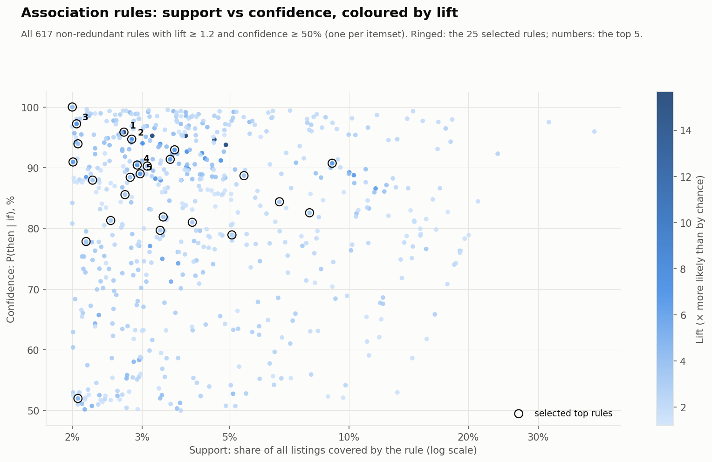

# Association rules

Generated 2026-11-24 21:08 by `src/association.py` from `outputs/clean_data.csv` and the market segments in `reports/location_clusters.csv`.

## 1. Transactions

Each of the 11,992 listings is a transaction with exactly one item from each of 7 attributes, 27 distinct items in total. Price bands are the quartiles from wrangling step 8; sqft is cut at its quartiles; bhk and bath are grouped as 1, 2, 3, 4+; listings in rare locations (grouped as 'other' in wrangling) have no market segment.

| item | support | listings |
|---|---|---|
| price=Low | 0.25 | 2,998 |
| price=Mid | 0.254 | 3,047 |
| price=High | 0.246 | 2,954 |
| price=Premium | 0.25 | 2,993 |
| sqft=1,116-1,305 | 0.25 | 3,003 |
| sqft=1,305-1,710 | 0.249 | 2,985 |
| sqft=1,710+ | 0.25 | 2,997 |
| sqft=<1,116 | 0.251 | 3,007 |
| bhk=1 | 0.0521 | 625 |
| bhk=2 | 0.434 | 5,201 |
| bhk=3 | 0.379 | 4,550 |
| bhk=4+ | 0.135 | 1,616 |
| bath=1 | 0.0612 | 734 |
| bath=2 | 0.539 | 6,466 |
| bath=3 | 0.257 | 3,082 |
| bath=4+ | 0.143 | 1,710 |
| area=Built-up | 0.193 | 2,319 |
| area=Carpet | 0.00684 | 82 |
| area=Plot | 0.111 | 1,333 |
| area=Super built-up | 0.689 | 8,258 |
| status=ready | 0.786 | 9,428 |
| status=under construction | 0.214 | 2,564 |
| segment=Budget (under construction) | 0.104 | 1,248 |
| segment=Mid-market | 0.185 | 2,224 |
| segment=Premium (more bedrooms, large homes) | 0.0928 | 1,113 |
| segment=Upper mid-market (high volume) | 0.389 | 4,666 |
| segment=none (rare location) | 0.229 | 2,741 |

## 2. Apriori vs FP-Growth

Apriori grows itemsets level by level and rescans the table for each level; FP-Growth compresses the table into a prefix tree once and mines it without generating candidates. Both are exact, so they must return the same itemsets. Median of up to 5 runs each (fewer for runs that take more than 10 s in total):

| min_support | itemsets | longest_itemset | apriori_ms | apriori_runs | fpgrowth_ms | fpgrowth_runs | fpgrowth_vs_apriori | same_itemsets | max_support_difference |
|---|---|---|---|---|---|---|---|---|---|
| 0.01 | 2,614 | 7 | 400.55 | 5 | 53,246 | 1 | 132.93 | 1 | 0 |
| 0.02 | 1,511 | 7 | 274.45 | 5 | 27,464 | 1 | 100.07 | 1 | 0 |
| 0.05 | 514 | 6 | 96.22 | 5 | 8,308 | 2 | 86.35 | 1 | 0 |
| 0.1 | 189 | 5 | 33.47 | 5 | 2,579 | 4 | 77.06 | 1 | 0 |

Here FP-Growth is **77–133× slower** than Apriori, the opposite of the textbook result. The theory assumes many distinct items and sparse transactions, where Apriori drowns in candidates. This table is the opposite case: only 27 items, and every listing has exactly 7 of them (dense data, long patterns). mlxtend's Apriori counts candidates with vectorised NumPy operations, which is cheap for 27 columns, while its FP-Growth builds and recursively mines the tree in pure Python. The algorithm's complexity matters less than the data shape and the implementation.

Both algorithms returned identical itemsets with identical supports at every threshold.

## 3. Rules

From the 1,511 itemsets with support ≥ 2%: 3,737 rules have lift ≥ 1.2 and confidence ≥ 50%. 1,915 of them are redundant (a rule with fewer conditions and the same conclusion is at least as confident) and are removed, leaving 1,822. Keeping only single-item conclusions and, for each itemset, its most confident rule leaves 617.

Ranking those purely by lift puts one pattern (small, cheap 1-BHK flats with 1 bathroom, ~320 listings) in every one of the top 25 places, rewritten with different items on each side. So the top 25 are picked greedily: go down the lift ranking and skip a rule if the listings it covers overlap more than 50% (Jaccard) with a rule already chosen. Result:

| rank | if | then | support | confidence | lift | consequent_support | listings | leverage | conviction |
|---|---|---|---|---|---|---|---|---|---|
| 1 | area=Super built-up & bhk=1 & price=Low | bath=1 | 0.027 | 0.959 | 15.66 | 0.0612 | 324 | 0.0253 | 22.67 |
| 2 | area=Plot & bath=4+ & price=Premium & sqft=1,710+ & status=ready | bhk=4+ | 0.0283 | 0.947 | 7.03 | 0.135 | 339 | 0.0242 | 16.30 |
| 3 | bhk=4+ & status=under construction | bath=4+ | 0.0205 | 0.972 | 6.82 | 0.143 | 246 | 0.0175 | 30.99 |
| 4 | area=Built-up & bath=4+ | bhk=4+ | 0.0292 | 0.904 | 6.71 | 0.135 | 350 | 0.0248 | 9.05 |
| 5 | bath=4+ & segment=none (rare location) & sqft=1,710+ | bhk=4+ | 0.0297 | 0.89 | 6.60 | 0.135 | 356 | 0.0252 | 7.87 |
| 6 | area=Super built-up & bhk=4+ & price=Premium | bath=4+ | 0.0363 | 0.929 | 6.52 | 0.143 | 435 | 0.0307 | 12.16 |
| 7 | bhk=4+ & segment=Upper mid-market (high volume) & sqft=1,710+ | bath=4+ | 0.0354 | 0.914 | 6.41 | 0.143 | 424 | 0.0298 | 9.95 |
| 8 | bhk=4+ & segment=Premium (more bedrooms, large homes) & sqft=1,710+ | bath=4+ | 0.0201 | 0.909 | 6.38 | 0.143 | 241 | 0.0169 | 9.47 |
| 9 | bhk=4+ & price=Premium & sqft=1,710+ | bath=4+ | 0.0906 | 0.907 | 6.36 | 0.143 | 1,087 | 0.0764 | 9.25 |
| 10 | bhk=4+ & segment=none (rare location) & status=ready | area=Plot | 0.0207 | 0.52 | 4.68 | 0.111 | 248 | 0.0163 | 1.85 |
| 11 | area=Super built-up & bath=4+ & price=Premium & segment=Upper mid-market (high volume) | sqft=1,710+ | 0.02 | 1.00 | 4.00 | 0.25 | 240 | 0.015 | inf |
| 12 | bath=1 & segment=Upper mid-market (high volume) | sqft=<1,116 | 0.0207 | 0.939 | 3.75 | 0.251 | 248 | 0.0152 | 12.36 |
| 13 | area=Super built-up & segment=Premium (more bedrooms, large homes) & sqft=1,710+ | price=Premium | 0.0309 | 0.903 | 3.62 | 0.25 | 371 | 0.0224 | 7.71 |
| 14 | area=Super built-up & price=Premium & segment=Upper mid-market (high volume) & status=ready | sqft=1,710+ | 0.028 | 0.884 | 3.54 | 0.25 | 336 | 0.0201 | 6.48 |
| 15 | bath=1 | sqft=<1,116 | 0.0543 | 0.887 | 3.54 | 0.251 | 651 | 0.0389 | 6.63 |
| 16 | bath=4+ & bhk=3 | sqft=1,710+ | 0.0225 | 0.879 | 3.52 | 0.25 | 270 | 0.0161 | 6.22 |
| 17 | price=Premium & segment=Upper mid-market (high volume) | sqft=1,710+ | 0.0667 | 0.844 | 3.38 | 0.25 | 800 | 0.047 | 4.80 |
| 18 | area=Super built-up & bhk=3 & price=High & sqft=1,710+ | bath=3 | 0.0272 | 0.856 | 3.33 | 0.257 | 326 | 0.019 | 5.15 |
| 19 | area=Super built-up & price=Premium & status=ready | sqft=1,710+ | 0.0795 | 0.826 | 3.30 | 0.25 | 953 | 0.0554 | 4.31 |
| 20 | price=Premium & status=under construction | sqft=1,710+ | 0.0339 | 0.819 | 3.28 | 0.25 | 407 | 0.0236 | 4.14 |
| 21 | area=Built-up & bhk=2 & price=Low & status=ready | sqft=<1,116 | 0.025 | 0.813 | 3.24 | 0.251 | 300 | 0.0173 | 4.01 |
| 22 | area=Built-up & price=Premium | sqft=1,710+ | 0.0402 | 0.81 | 3.24 | 0.25 | 482 | 0.0278 | 3.95 |
| 23 | segment=none (rare location) & sqft=1,710+ | price=Premium | 0.0506 | 0.789 | 3.16 | 0.25 | 607 | 0.0346 | 3.56 |
| 24 | bhk=3 & price=Premium & segment=Premium (more bedrooms, large homes) & status=ready | sqft=1,710+ | 0.0217 | 0.778 | 3.11 | 0.25 | 260 | 0.0147 | 3.39 |
| 25 | area=Super built-up & bhk=3 & segment=Upper mid-market (high volume) & sqft=1,710+ | bath=3 | 0.0334 | 0.797 | 3.10 | 0.257 | 400 | 0.0226 | 3.66 |

## 4. The five best rules in plain English

1. Of the listings that are listed as Super built-up area and 1 BHK and in the Low price band (9–50 lakhs), **96%** are 1 bathroom, against 6% of all listings: **15.66× as likely**. The rule covers 324 listings (2.7%).
2. Of the listings that are listed as Plot area and 4 or more bathrooms and in the Premium price band (120–2912 lakhs) and 1,710+ sq ft and ready to move, **95%** are 4 or more BHK, against 13% of all listings: **7.03× as likely**. The rule covers 339 listings (2.8%).
3. Of the listings that are 4 or more BHK and under construction, **97%** are 4 or more bathrooms, against 14% of all listings: **6.82× as likely**. The rule covers 246 listings (2.1%).
4. Of the listings that are listed as Built-up area and 4 or more bathrooms, **90%** are 4 or more BHK, against 13% of all listings: **6.71× as likely**. The rule covers 350 listings (2.9%).
5. Of the listings that are 4 or more bathrooms and in a rare location and 1,710+ sq ft, **89%** are 4 or more BHK, against 13% of all listings: **6.60× as likely**. The rule covers 356 listings (3.0%).

Caveats: rules describe co-occurrence in these listings, not cause and effect. Market segments were built from location averages (including the share ready to move), so rules linking a segment to readiness partly restate how the segment was defined.
