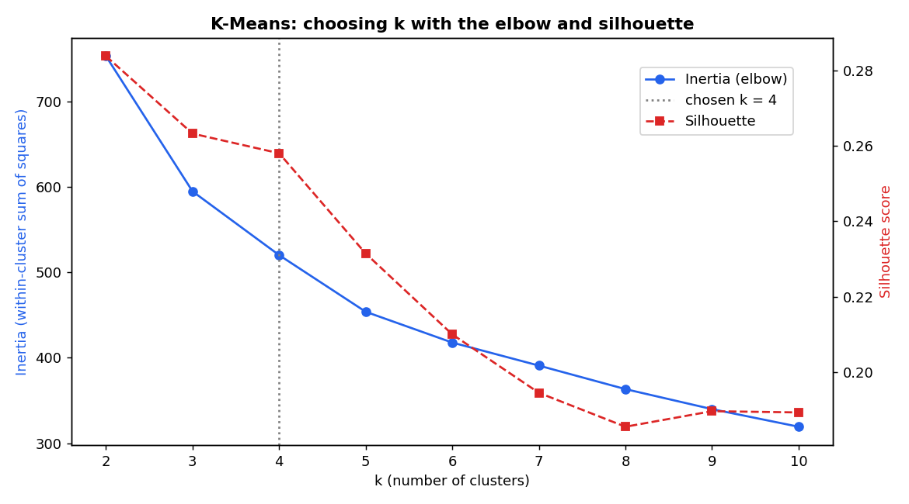
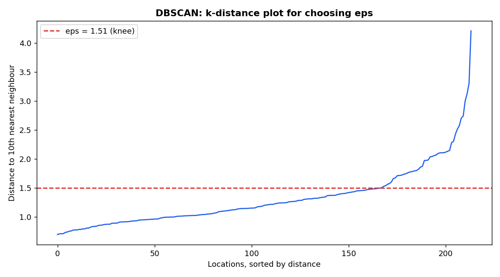
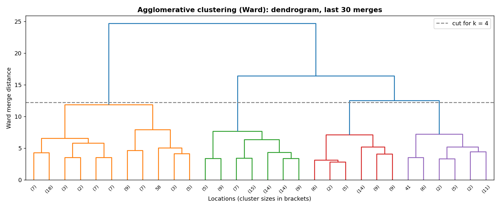
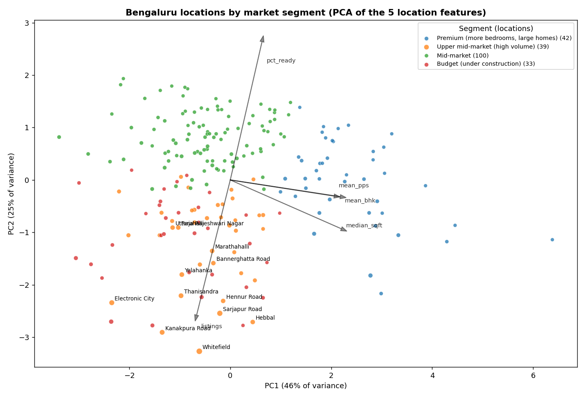

# Clustering report: location market segments

Generated 2026-11-23 21:42 by `src/clustering.py` from `outputs/clean_data.csv`.

## 1. Location table

- 214 locations (all with more than 10 clean listings; the 'other' bucket is excluded because it mixes many unrelated rare locations).
- Features: mean price per sq ft (₹), median sqft, mean bhk, listing count, share ready to move.
- mean_pps, median_sqft, listings are right-skewed (skewness mean_pps 2.35, median_sqft 2.87, listings 4.75), so they are logged; then every feature is standardised (mean 0, std 1) so that no feature dominates the distances because of its units.

| feature | count | mean | std | min | 25% | 50% | 75% | max |
|---|---|---|---|---|---|---|---|---|
| mean_pps | 214.00 | 6,190 | 2,208 | 3,118 | 4,823 | 5,633 | 6,709 | 20,632 |
| median_sqft | 214.00 | 1,388 | 367.45 | 782.00 | 1,200 | 1,290 | 1,455 | 3,815 |
| mean_bhk | 214.00 | 2.65 | 0.333 | 1.75 | 2.44 | 2.64 | 2.85 | 3.62 |
| listings | 214.00 | 43.23 | 57.41 | 11.00 | 16.00 | 26.00 | 46.00 | 523.00 |
| pct_ready | 214.00 | 0.819 | 0.192 | 0 | 0.737 | 0.877 | 0.971 | 1.00 |

## 2. K-Means: choosing k

| k | inertia | silhouette | davies_bouldin | smallest_cluster |
|---|---|---|---|---|
| 2 | 753.16 | 0.284 | 1.34 | 69 |
| 3 | 594.81 | 0.263 | 1.32 | 47 |
| 4 | 520.18 | 0.258 | 1.25 | 33 |
| 5 | 453.85 | 0.231 | 1.31 | 21 |
| 6 | 417.79 | 0.21 | 1.31 | 9 |
| 7 | 390.85 | 0.195 | 1.39 | 9 |
| 8 | 363.28 | 0.186 | 1.41 | 9 |
| 9 | 339.86 | 0.19 | 1.34 | 9 |
| 10 | 319.25 | 0.189 | 1.33 | 8 |

Silhouette is highest at k = 2 (0.284). The k values within 10% of that are 2, 3, 4; among them, k = 4 has the lowest Davies-Bouldin (1.247, also the lowest of all k), so **k = 4**. The elbow of the inertia curve is at k = 5 (silhouette 0.231, more than 10% below the best, so not used). Silhouette alone favours k = 2 ("expensive vs not"), which the PCA plot shows misses the split between large under-construction corridors and small established localities.
Even the best silhouette (0.284) is modest (values above ~0.5 indicate strong structure): Bengaluru locations form a continuum rather than well-separated groups, so the segments are a useful summary of that continuum, not natural categories.

## 3. DBSCAN

`min_samples = 10` (2 × number of features, a common rule of thumb). `eps = 1.51` is the knee of the k-distance plot: below it distances grow slowly (points inside dense regions), above it they shoot up (isolated points).
Result: 1 cluster(s) and 19 noise locations. DBSCAN finds one dense core and calls the outlying locations noise: the data has no separate dense regions, which agrees with the low silhouette scores. Its noise points are the unusual locations (see `dbscan = -1` in `location_clusters.csv`).

## 4. Agglomerative (Ward)

Ward linkage merges the pair of clusters that increases within-cluster variance the least. Cut at k = 4 to compare like for like with K-Means. (The largest jump in merge height, the dendrogram's own suggestion, is at k = 2.)

Agreement between K-Means (rows) and Agglomerative (columns) labels:

| kmeans | agg_0 | agg_1 | agg_2 | agg_3 |
|---|---|---|---|---|
| 0 | 26 | 1 | 66 | 7 |
| 1 | 0 | 26 | 6 | 1 |
| 2 | 1 | 0 | 1 | 37 |
| 3 | 42 | 0 | 0 | 0 |

## 5. Comparison

| method | settings | clusters | noise | silhouette | davies_bouldin | smallest_cluster |
|---|---|---|---|---|---|---|
| K-Means | k=4, n_init=20 | 4 | 0 | 0.258 | 1.25 | 33 |
| DBSCAN | eps=1.51, min_samples=10 | 1 | 19 |  |  | 195 |
| Agglomerative (Ward) | k=4 | 4 | 0 | 0.223 | 1.28 | 27 |

Silhouette: higher is better (−1 … 1). Davies-Bouldin: lower is better. For DBSCAN both are computed without the noise points, which flatters it. **Chosen: K-Means.** K-Means has the best combined rank on silhouette (0.258) and Davies-Bouldin (1.247) among the usable methods. Not usable as a segmentation: DBSCAN (fewer than 2 clusters or more than 10% of locations labelled noise).

## 6. Market segments

Names come from the profiles: the price tier is the rank of the segment's mean price per sq ft; a qualifier is added when the segment centre is at least 0.5 std above or below the average location on that feature.

| segment | locations | total_listings | mean_pps | median_sqft | mean_bhk | mean_listings | pct_ready | examples |
|---|---|---|---|---|---|---|---|---|
| Premium (more bedrooms, large homes) | 42 | 1,113 | 9,071 | 1,884 | 3.11 | 26.50 | 0.899 | Rajaji Nagar, Koramangala, Malleshwaram, Thigalarapalya, Brookefield |
| Upper mid-market (high volume) | 39 | 4,666 | 5,712 | 1,347 | 2.60 | 119.64 | 0.774 | Whitefield, Sarjapur Road, Electronic City, Kanakpura Road, Thanisandra |
| Mid-market | 100 | 2,224 | 5,487 | 1,234 | 2.53 | 22.24 | 0.914 | Hulimavu, Jigani, Budigere, Gottigere, Rachenahalli |
| Budget (under construction) | 33 | 1,248 | 5,217 | 1,269 | 2.52 | 37.82 | 0.484 | Electronic City Phase II, Hoodi, Chandapura, Hosa Road, 8th Phase JP Nagar |

Note: these adjacent segments differ by less than 10% in mean price per sq ft: Upper mid-market (high volume) vs Mid-market; Mid-market vs Budget (under construction). The tier names only rank them; what really separates them is the other features (listing volume and share ready to move), shown in the qualifiers and the table.

## 7. PCA view

PC1 and PC2 explain 46% and 25% of the variance (71% together). Loadings (how much each feature contributes to each axis):

| feature | PC1 | PC2 |
|---|---|---|
| mean_pps | 0.537 | -0.0802 |
| median_sqft | 0.575 | -0.243 |
| mean_bhk | 0.569 | -0.0835 |
| listings | -0.174 | -0.673 |
| pct_ready | 0.164 | 0.689 |

## Caveat for later use

The segments are built from mean price per sq ft, i.e. from prices. Using a segment as a feature in the price model would leak target information unless the segments were rebuilt inside each training fold.
