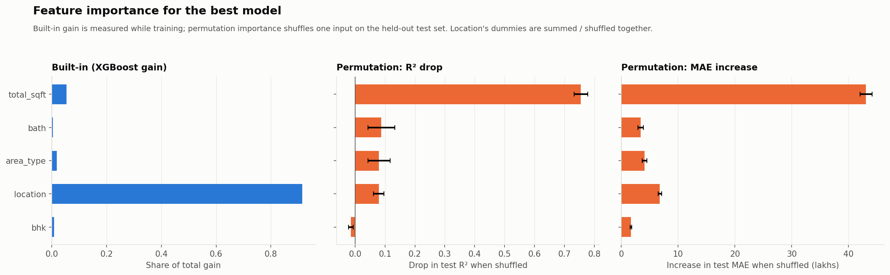
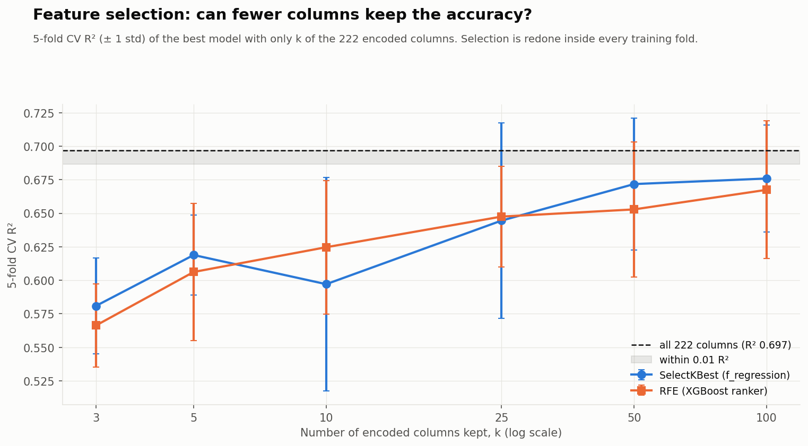

# Feature importance and selection

Generated 2026-11-24 15:27 by `src/features.py`.

Model: the tuned **XGBoost** from `src/modeling.py` (log-log target), refitted on the same 9,593 training rows; held-out test R² 0.639, MAE 29.33 lakhs. The 5 input features become 222 encoded columns (215 location dummies, 4 area_type dummies, 3 numbers).

## 1. Importance per feature

| feature | gain_share | perm_r2_drop | perm_r2_drop_std | perm_mae_increase | perm_mae_increase_std |
|---|---|---|---|---|---|
| total_sqft | 0.0541 | 0.756 | 0.0228 | 43.08 | 1.04 |
| bath | 0.00445 | 0.0879 | 0.0448 | 3.39 | 0.477 |
| area_type | 0.018 | 0.0797 | 0.0372 | 4.08 | 0.399 |
| location | 0.915 | 0.0795 | 0.0176 | 6.78 | 0.315 |
| bhk | 0.00828 | -0.0138 | 0.00811 | 1.68 | 0.133 |

- **gain_share**: XGBoost's built-in importance, the share of the total loss reduction from splits on that feature, with dummies summed. It is measured on the training data and only says how much the trees *used* a feature.
- **perm_r2_drop / perm_mae_increase**: shuffle one column of the held-out test set 10 times and measure how much worse the predictions get (MAE in lakhs). This is how much the model *needs* the feature to predict unseen listings.

The two methods rank the features differently (total_sqft, bath, location, bhk). Permutation importance is the more reliable guide: gain is computed on training data and favours features with many possible split points. Note also that total_sqft, bhk and bath are correlated: when one is shuffled the others still carry part of its information, so permutation understates each of them individually.

Top encoded columns by built-in gain (before summing dummies):

| column | feature | gain_share |
|---|---|---|
| total_sqft | total_sqft | 0.0541 |
| location_Rajaji Nagar | location | 0.0198 |
| location_Electronic City Phase II | location | 0.0143 |
| location_Chandapura | location | 0.0141 |
| location_HSR Layout | location | 0.0137 |
| location_Malleshwaram | location | 0.0124 |
| location_Koramangala | location | 0.0122 |
| area_type_Plot Area | area_type | 0.0119 |
| location_JP Nagar | location | 0.011 |
| location_Cunningham Road | location | 0.0108 |
| location_Indira Nagar | location | 0.0107 |
| location_Electronic City | location | 0.0106 |
| location_Begur Road | location | 0.0101 |
| location_Whitefield | location | 0.0101 |
| location_Hebbal | location | 0.00993 |

## 2. Feature selection

Both selectors sit *inside* the pipeline, between preprocessing and the model, so in each CV fold they choose columns from the training folds only. **SelectKBest** keeps the k columns with the strongest univariate linear relationship with (log) price (F-test). **RFE** fits a smaller XGBoost, drops the 10% least important columns, and repeats until k remain, so it accounts for interactions. k counts encoded columns (out of 222).

| method | k | cv_r2_mean | cv_r2_std | cv_mae_mean | cv_mae_std | cv_rmse_mean | cv_rmse_std | kept |
|---|---|---|---|---|---|---|---|---|
| all features | 222 | 0.697 | 0.0429 | 30.04 | 1.23 | 80.97 | 7.07 | everything |
| SelectKBest (f_regression) | 3 | 0.581 | 0.0358 | 37.44 | 0.936 | 95.35 | 7.38 | total_sqft, bath, bhk |
| SelectKBest (f_regression) | 5 | 0.619 | 0.0297 | 36.02 | 1.19 | 91.01 | 7.71 | area_type (2 dummies), total_sqft, bath, bhk |
| SelectKBest (f_regression) | 10 | 0.597 | 0.0798 | 34.52 | 1.25 | 92.96 | 8.55 | location (5 dummies), area_type (2 dummies), total_sqft, bath, bhk |
| SelectKBest (f_regression) | 25 | 0.645 | 0.073 | 32.43 | 0.931 | 87.31 | 8.62 | location (20 dummies), area_type (2 dummies), total_sqft, bath, bhk |
| SelectKBest (f_regression) | 50 | 0.672 | 0.0492 | 31.25 | 1.29 | 84.22 | 7.81 | location (45 dummies), area_type (2 dummies), total_sqft, bath, bhk |
| SelectKBest (f_regression) | 100 | 0.676 | 0.0401 | 30.60 | 1.31 | 83.81 | 7.54 | location (95 dummies), area_type (2 dummies), total_sqft, bath, bhk |
| RFE (XGBoost ranker) | 3 | 0.566 | 0.0312 | 36.98 | 1.06 | 97.08 | 7.78 | location (1 dummies), area_type (1 dummies), total_sqft |
| RFE (XGBoost ranker) | 5 | 0.606 | 0.0512 | 35.52 | 1.43 | 92.63 | 11.21 | location (3 dummies), area_type (1 dummies), total_sqft |
| RFE (XGBoost ranker) | 10 | 0.625 | 0.0498 | 34.15 | 0.937 | 90.19 | 9.08 | location (7 dummies), area_type (1 dummies), total_sqft, bhk |
| RFE (XGBoost ranker) | 25 | 0.648 | 0.0374 | 32.67 | 1.40 | 87.61 | 9.30 | location (22 dummies), area_type (1 dummies), total_sqft, bhk |
| RFE (XGBoost ranker) | 50 | 0.653 | 0.0504 | 31.68 | 1.34 | 86.69 | 8.79 | location (46 dummies), area_type (1 dummies), total_sqft, bath, bhk |
| RFE (XGBoost ranker) | 100 | 0.667 | 0.0514 | 30.82 | 1.17 | 84.84 | 8.81 | location (96 dummies), area_type (1 dummies), total_sqft, bath, bhk |

"Similar accuracy" here means CV R² no more than 0.01 below and CV MAE no more than 2% above the all-features model (R² 0.6968, MAE 30.04). No tested k qualifies: every reduction costs noticeable accuracy.

